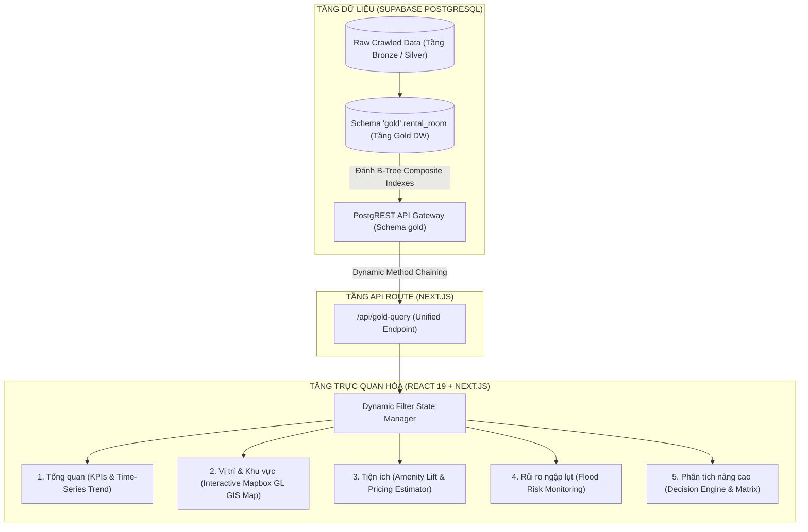

# RentIQ · Da Nang Rental Market Analytics & Real Estate Intelligence Platform

## Chạy trên điện thoại cùng mạng Wi‑Fi

Trên máy tính chạy:

```powershell
npm run dev:lan
ipconfig
```

Lấy địa chỉ `IPv4 Address` của Wi‑Fi, ví dụ `192.168.1.10`, rồi mở trên điện thoại:
`http://192.168.1.10:3000`. Hai thiết bị phải cùng mạng Wi‑Fi và Windows Firewall phải cho phép Node.js qua mạng Private.

Nếu cần HTTPS local:

```powershell
npm run dev:lan:https
```

Mở `https://192.168.1.10:3000`; chứng chỉ tự ký sẽ hiện cảnh báo trên điện thoại. Đây là giới hạn của chứng chỉ local, không phải lỗi ứng dụng. Muốn hết cảnh báo cần dùng `mkcert` và cài CA vào điện thoại, hoặc deploy bằng domain HTTPS thật.

<p align="center">
  
  
  
  
  
  
</p>

---

## 📌 Giới Thiệu Dự Án (Project Overview)

**RentIQ** là nền tảng phân tích dữ liệu thị trường và cố vấn quyết định đầu tư bất động sản cho thuê tại Thành phố Đà Nẵng. Hệ thống khai thác kho dữ liệu tinh chế (**Data Warehouse tầng Gold**) được xây dựng trên nền tảng **Supabase / PostgreSQL**, kết hợp kiến trúc **Dynamic Query Engine** ở tầng Front-end để mang lại trải nghiệm khám phá dữ liệu tương tác phản xạ tức thì (Reactive Data Exploration).

Khác biệt với các website đăng tin thông thường, RentIQ tập trung vào **Khai phá Insight kinh tế lượng (Econometric Insights)**:
- Đo lường định lượng mức độ ảnh hưởng của cự ly điểm nóng (Bãi biển, Lõi CBD, Cụm trường Đại học, Sân bay) tới giá thuê.
- Phân tích đòn bẩy lợi nhuận từ việc nâng cấp nội thất và trang bị tiện ích phòng.
- Giám sát rủi ro ngập lụt thực tế qua các đợt ngập lịch sử (2022, 2025) để bảo vệ dòng tiền đầu tư.
- Trực quan hóa không gian GIS với hơn 3,200 tọa độ thực tế trên bản đồ hiệu năng cao 60 FPS.

---

## 🏗️ Kiến Trúc Hệ Thống (Architecture & Tech Stack)

Hệ thống được thiết kế theo mô hình chuẩn **Modern Data Stack** kết hợp kiến trúc **Frontend-Centric Dynamic Query Builder**:



### Công Nghệ Chủ Đạo:
- **Core Framework:** [Next.js 16](https://nextjs.org/) (App Router, Turbopack, React 19).
- **Ngôn ngữ:** TypeScript 100% Type-Safe.
- **Database & Data Warehouse:** [Supabase](https://supabase.com/) (PostgreSQL 15+, PostgREST, RLS Policies).
- **Spatial / GIS Visualization:** Mapbox GL JS qua `react-map-gl`, GeoJSON native clustering và các lớp phủ GeoJSON.
- **Icons & Theme:** Lucide React, Design System tối giản, trực quan hóa dữ liệu theo chuẩn Dashboard hiện đại.

---

## 💎 Cấu Trúc Dữ Liệu Tầng Gold (`gold.rental_room`)

Tầng Gold của kho dữ liệu áp dụng mô hình **Bảng phẳng chuẩn hóa (Flattened / Denormalized Table)** với 3,238 bản ghi thực tế, sẵn sàng cho các câu lệnh truy vấn phân tích tức thì:

| Nhóm thuộc tính | Danh sách cột | Ý nghĩa phân tích |
| :--- | :--- | :--- |
| **Khóa & Nguồn** | `source`, `list_id` | Khóa chính tổng hợp xác thực bài đăng |
| **Mốc thời gian** | `posted_date` | Chuỗi thời gian phục vụ vẽ xu hướng nguồn cung và giá theo chu kỳ |
| **Chỉ số đo lường** | `price_vnd`, `size_m2`, `price_per_m2_vnd` | Đơn giá, diện tích và đơn giá chuẩn hóa theo $m^2$ |
| **Cự ly điểm nóng** | `dist_to_cbd`, `dist_to_beach`, `dist_to_airport`, `dist_to_nearest_uni` | Khoảng cách không gian (km) tới các trung tâm kinh tế, du lịch và giáo dục |
| **Phân loại & Vị trí**| `category_name`, `ward_name`, `furnishing_status`, `latitude`, `longitude` | Chiều phân tích theo quận/huyện, loại hình (Căn hộ / Phòng trọ) và tọa độ GIS |
| **Chỉ số rủi ro** | `flood_risk_label`, `flooded_2022`, `flooded_2025` | Đánh giá mức độ an toàn địa hình thoát nước và nhật ký ngập úng thực địa |
| **Cờ tiện ích (0/1)** | `has_balcony`, `has_elevator`, `private_bathroom`, `has_parking`, `free_hours`, `has_window`, `has_mezzanine`, `wifi`, `has_camera_security` | 9 tiện ích cấu thành giá trị gia tăng của phòng trọ |

---

## ⚡ Tối Ưu Hóa Tầng Database & Trình Dựng Truy Vấn Động

### 1. Chỉ mục B-Tree Composite (PostgreSQL Indexes)
Để đảm bảo tốc độ phản hồi dưới **10ms** khi người dùng kết hợp nhiều bộ lọc cùng lúc, bảng `gold.rental_room` đã được tối ưu hóa bằng các index chuyên biệt:
```sql
CREATE INDEX idx_rental_room_price ON gold.rental_room USING btree (price_vnd);
CREATE INDEX idx_rental_room_size ON gold.rental_room USING btree (size_m2);
CREATE INDEX idx_rental_room_posted_price ON gold.rental_room USING btree (posted_date DESC, price_vnd ASC);
CREATE INDEX idx_rental_room_filter_combo ON gold.rental_room USING btree (ward_name, category_name, price_vnd);
```
> **Benchmark thực tế:** Câu lệnh kiểm thử `EXPLAIN ANALYZE` với bộ lọc đa điều kiện chuyển sang sử dụng `Bitmap Index Scan on idx_rental_room_filter_combo` đạt tốc độ **~6.33 ms**.

### 2. Trình Dựng Truy Vấn Động (Dynamic Query Chaining)
File service `lib/goldQueryService.ts` được thiết kế module hóa, chỉ kích hoạt method chaining trên PostgREST đối với các tiêu chí lọc đang hoạt động (`active filters`), tự động bỏ qua các giá trị rỗng hoặc `all`:
- **Categorical:** `.eq()` (nếu chọn đơn) hoặc `.in()` (nếu chọn đa mục).
- **Numerical Ranges:** `.gte()` và `.lte()` trên giá thuê, diện tích.
- **Fulltext / Keyword:** `.or('ward_name.ilike.%...,category_name.ilike.%...')`
- **Pagination & Sorting:** `.order(col, { ascending })` kết hợp `.range(from, to)` bảo vệ giao diện khỏi tràn bộ nhớ.

---

## 🚀 Các Tính Năng Chuyên Sâu Trên 5 Phân Hệ Workspace

### 1. 📊 Dashboard Tổng Quan (Executive Overview)
- **KPI Real-time:** Tổng số tin đăng sau lọc, đơn giá thuê trung bình, diện tích trung bình, tỷ lệ an toàn ngập lụt.
- **Biểu đồ Xu hướng Thị trường:** Vẽ đường SVG spline thể hiện biến động giá và lượng tin đăng thực tế theo chu kỳ ngày đăng.
- **Biểu đồ Conic Donut:** Phân bổ tỷ trọng các phân khúc giá ($<4$ triệu, $4-6$ triệu, $6-10$ triệu, $>10$ triệu).
- **Xếp hạng nguồn cung:** Top khu vực dẫn đầu về quy mô tin đăng và mặt bằng giá.
- **Bảng dữ liệu thực tế:** Danh sách bài đăng hỗ trợ phân trang, đổi thứ tự sắp xếp và xuất dữ liệu CSV.

### 2. 🗺️ Vị Trí & Khu Vực (Interactive GIS Map)
- Trực quan hóa hơn **3,200 tọa độ thực tế** trên Mapbox GL JS với native GeoJSON clustering, popup tin đăng và lớp phủ GIS.
- Phân tầng màu sắc trực quan: Xanh dương (Căn hộ), Xanh lá (Phòng trọ), Cam (Phân khúc cao cấp $>10$ triệu).
- Tích hợp các mốc định vị POI: Cầu Rồng (CBD), Bãi biển Mỹ Khê & Phạm Văn Đồng, Sân bay Quốc tế, ĐH Bách Khoa, ĐH Kinh Tế.
- Tương tác thu phóng (Zoom), kéo thả (Pan), rê chuột xem nhanh Tooltip và click chọn mở thẻ kiểm tra chi tiết (Inspector Card).

### 3. 🛋️ Phân Tích Tiện Ích (Amenity Premium & Value Lift)
- Định lượng mức tăng giá (% Price Lift) cho 9 tiện ích: Ban công (+$50\%$), Thang máy (+$21\%$), WC riêng, Giờ tự do, Gác lửng...
- So sánh tác động trên đơn giá $VNĐ/m^2$ giữa nhóm có và không có tiện ích.
- **Landlord Pricing Estimator (Bộ mô phỏng định giá cho chủ nhà):** Chọn các tiện ích dự kiến trang bị $\rightarrow$ Thuật toán tự động đề xuất khung giá thuê tối ưu dựa trên dữ liệu biên lợi ích thực tế.

### 4. 🛡️ Giám Sát Rủi Ro Ngập Lụt (Flood Resilience Audit)
- Kiểm định dữ liệu thực địa: $99.9\%$ mẫu tin đăng ($3,237/3,238$) thuộc nhóm an toàn cốt nền cao (Mức 0).
- Bản đồ đánh giá địa hình thoát nước: Phân tách rõ rệt giữa vùng cát ven biển thoát nước tự nhiên (Sơn Trà, An Hải, Ngũ Hành Sơn) và vùng trũng lưu vực sông (Cẩm Lệ, Hòa Vang).
- Đo lường mức chiết khấu giá thuê ở các vùng trũng thấp (**$-18.4\%$**).
- Khuyến nghị xây dựng cốt nền và giải pháp hầm xe chống ngập cho nhà đầu tư.

### 5. 🎯 Phân Tích Nâng Cao & Cố Vấn Đầu Tư (AI Decision Engine)
- **Mô hình Suy giảm giá theo khoảng cách (Distance Decay Model):** Biểu đồ đo lường mức độ giảm giá khi nằm xa dần bãi biển, trung tâm CBD, sân bay hoặc trường đại học.
- **Đòn bẩy Đầu tư Nội thất (Capex-to-Rent):** So sánh 4 cấp độ từ *Không nội thất* ($6.5$ triệu) đến *Cao cấp* ($14.4$ triệu), ước tính thời gian hoàn vốn đầu tư nội thất chỉ trong 11 — 14 tháng.
- **Ma trận Cơ hội Đầu tư (Investment Score 0 — 100):** Bảng xếp hạng tiềm năng thị trường của từng quận/huyện dựa trên bài toán cân đối giữa nguồn cung, đơn giá, cự ly và độ an toàn.
- **Bộ Cố vấn Chiến lược Đa mục tiêu:** Đề xuất ngay khu vực vàng, khung giá mục tiêu và tiện ích bắt buộc phải có cho 3 nhóm đối tượng: Khai thác Expat/Du lịch, Dòng tiền Sinh viên/Công nhân, và Gia đình trẻ thuê lâu dài.

---

## 🛠️ Hướng Dẫn Cài Đặt & Chạy Cục Bộ (Getting Started)

### Yêu Cầu Môi Trường (Prerequisites)
- [Node.js](https://nodejs.org/) phiên bản 18.17+ trở lên (khuyến nghị Node 20+).
- Trình quản lý gói `npm` hoặc `pnpm`.

### 1. Clone Kho Mã Nguồn
```bash
git clone https://github.com/<your-username>/frontend_rental_analysis.git
cd frontend_rental_analysis
```

### 2. Cài Đặt Thư Viện Phụ Thuộc
```bash
npm install
```

### 3. Cấu Hình Biến Môi Trường
Tạo file `.env.local` tại thư mục gốc của dự án với các thông số Supabase và Mapbox. Lấy public access token trong Mapbox account, giới hạn token theo domain khi triển khai:
```env
NEXT_PUBLIC_SUPABASE_URL=https://vfvulyiabgfwujmjunva.supabase.co
NEXT_PUBLIC_SUPABASE_ANON_KEY=sb_publishable_b5FYMZo4Z0bKHQT4ZCkDKA_E65rMNfN
NEXT_PUBLIC_MAPBOX_TOKEN=pk.your_mapbox_public_token
```

### 4. Khởi Động Máy Chủ Phát Triển (Development Server)
```bash
npm run dev
```
Mở trình duyệt tại địa chỉ [http://localhost:3000](http://localhost:3000) để trải nghiệm giao diện.

### 5. Kiểm Tra Đóng Gói Production (Build Check)
```bash
npm run build
```

---

## 🌐 Hướng Dẫn Triển Khai Lên Vercel (Deployment)

1. Đẩy mã nguồn lên kho lưu trữ GitHub / GitLab.
2. Truy cập [Vercel](https://vercel.com/) và import dự án `frontend_rental_analysis`.
3. Trong mục **Environment Variables**, thêm 2 biến:
   - `NEXT_PUBLIC_SUPABASE_URL`
   - `NEXT_PUBLIC_SUPABASE_ANON_KEY`
   - `NEXT_PUBLIC_MAPBOX_TOKEN`
4. Nhấn **Deploy**. Vercel sẽ tự động build với Turbopack và phân phối ứng dụng lên Edge Network toàn cầu.

---

## 📂 Cấu Trúc Thư Mục Dự Án (Project Structure)

```text
├── app/
│   ├── api/
│   │   ├── gold-query/route.ts       # Unified API Endpoint (kpi, map, decay, matrix, flood...)
│   │   ├── kpi/route.ts              # Endpoint phân tích chỉ số KPI
│   │   ├── price-distribution/       # Endpoint phân bổ phổ giá
│   │   ├── recent-activity/          # Endpoint hoạt động bài đăng mới
│   │   └── wards/                    # Endpoint thống kê quận/huyện
│   ├── components/
│   │   ├── LocationMapView.tsx       # Phân hệ Bản đồ số GIS Canvas 60 FPS
│   │   ├── AmenitiesView.tsx         # Phân hệ Giá trị gia tăng tiện ích & Định giá
│   │   ├── FloodRiskView.tsx         # Phân hệ Giám sát rủi ro ngập lụt
│   │   └── AdvancedAnalyticsView.tsx # Phân hệ Phân tích nâng cao & Cố vấn đầu tư
│   ├── globals.css                   # Hệ thống Style và Design Token toàn cục
│   ├── layout.tsx                    # Layout gốc của Next.js
│   └── page.tsx                      # Dashboard điều hướng chính & Tổng quan
├── lib/
│   ├── database.types.ts             # Định nghĩa Type schema Supabase tầng Gold
│   ├── goldQueryService.ts           # Dynamic Query Builder & Econometric Calculators
│   └── supabase.ts                   # Supabase Client cấu hình schema 'gold'
├── .env.local                        # Cấu hình biến môi trường kết nối Supabase
├── package.json                      # Danh mục thư viện và script thực thi
├── tsconfig.json                     # Cấu hình TypeScript nghiêm ngặt
└── README.md                         # Tài liệu kỹ thuật dự án
```

---

## 👨‍💻 Tác Giả & Bản Quyền (Author & License)

- **Lead Engineer & Architect:** TEAM 2 (Full-stack Data Engineer & Frontend Architect)
- **Dự án:** Phân tích Dữ liệu Bất động sản Thị trường Cho thuê Đà Nẵng
- **Giấy phép:** [MIT License](LICENSE)
